# Switchboard: LibreChat Mobile Client

[](https://github.com/LibreChat-AI/LibreChat/releases/tag/v0.8.8)

A third-party native mobile client for [LibreChat](https://www.librechat.ai/) (Android & iOS). Not affiliated with the official LibreChat project — this is an independent app that connects to any self-hosted LibreChat server, no backend modifications required.

> **Backend compatibility:** Tested against LibreChat **v0.8.4 – v0.8.8**. Older releases may work but are not guaranteed; newer releases are supported on a best-effort basis until the next sync.

## Why use this instead of the web app?

- **Smoother and faster** — a real native app instead of a website in a wrapper, so scrolling, typing, and watching responses stream in all feel snappier.
- **Feels like a mobile app, not a shrunk-down website** — familiar gestures like swipe to switch accounts and swipe back, menus you can press, drag and release in one motion, comfortable tap targets, and a layout that adapts to tablets and foldables — including the iPhone Duo.
- **Make it yours** — switch between Material and Liquid Glass styles on Android or iPhone, pick any accent color and watch the whole app recolor around it, or let it match your wallpaper.
- **Plays nicely with your phone** — share text, images, and files into the app from anywhere *(Android)*, pin your favorite models or generated content to your home screen, open chat links straight into the right screen, and save or share images through your phone's normal menus.
- **Works without a connection** — your chat list and any conversations you've opened are saved on your phone, so you can keep reading with spotty or no signal. Turn on background prefetch and recent chats are ready offline before you even open them.
- **Find anything you've ever asked** — search every message in every chat, even offline, and jump straight to the one you meant.
- **Multiple accounts, one app** — sign in to different accounts on different LibreChat servers and switch between them instantly, no re-entering passwords.
- **Dictation without a round trip** — voice typing uses your phone's own speech recognizer, on-device where the phone supports it, instead of uploading audio to your server.

## Features

- **Make It Yours** — Two complete looks: Google's Material design or Apple-style Liquid Glass, on Android and iOS alike. Pick any accent color and the whole app recolors to match — choose a preset or dial in your own — or let Material You pull colors from your wallpaper on Android 12+. Light, dark, or follow the system, and choose how chats look (thread or two-sided, bubbles, avatars) with a live preview.
- **Multi-Account & Multi-Server** — Sign in to multiple accounts across different LibreChat servers and switch between them instantly, no re-login. Swipe the account chip to switch; storage is fully scoped per account.
- **Pin Artifacts to Home Screen** — Turn any generated artifact (HTML, React, SVG, Mermaid, Markdown) into a home-screen launcher icon that opens straight into a full-screen viewer — works on cold start, while logged out, and even after the source chat is deleted. *(Android)*
- **Quick Actions** — Your most-used models become home-screen shortcuts (Android) and long-press quick actions (iOS) that deep-link into a new chat with that model preselected.
- **Rich Media Viewer** — Full-screen, Google-Photos-style viewer with pinch-to-zoom and swipe between images across a branch or grid, shared by chat and files.
- **Native Upload, Share & Save** — Attach from the device or reuse existing server files without re-uploading, save images to your gallery, and share out through the system share sheet with original format preserved.
- **Chat** — Real-time streaming (SSE), message branching & sibling navigation, stop/regenerate/continue, markdown with syntax highlighting, LaTeX math rendering, code blocks with copy, image display, file attachments, tool call progress cards
- **Search** — Find any message across all your chats, even offline, right from the sidebar. Tap a result and the chat opens on that exact message.
- **Answer Your Agents** — When an agent stops to ask you something or wants your OK before running a tool, answer right from the composer, one question at a time.
- **Inline Artifacts** — Render Mermaid, SVG, HTML, React, and Markdown artifacts directly in chat messages at full message width with content-fit height. Per-type toggle in Settings → Chat → Artifacts.
- **Model Selection** — Searchable bottom sheet grouped by endpoint, star your favorites to keep them on top, and compare two models side by side
- **Agents** — Marketplace with search and categories, MCP server configuration
- **Projects & Scheduled Chats** — Group related chats into projects, and have an agent run a prompt on a schedule, filing each conversation into a project for you.
- **Skills** — Create, import, and edit skills: reusable instructions and files your agents can draw on.
- **Conversations** — Paginated list with date grouping, tags, search, rename, archive, delete, share, fork, duplicate, export/import
- **Voice** — On-device live dictation (Android & iOS) with cloud fallback, plus text-to-speech playback
- **Mobile & Tablet** — Single adaptive UI: single-pane on phones, dual-pane layout with a persistent sidebar on tablets and foldables, with native predictive-back gestures
- **Settings** — In-app language switching across 10 languages, account management, data controls
- **Accessibility** — Semantic headings, content descriptions, 48dp touch targets, live regions

## Screenshots

<p align="center">
  
</p>
<p align="center"><b>Two looks, one app.</b> The same chat in Material and in Liquid Glass.</p>

| Feature | Phone | Tablet / Foldable |
|---|---|---|
| **Make It Yours** — Pick Material or Liquid Glass, any accent color, light or dark, and the whole app follows |  | 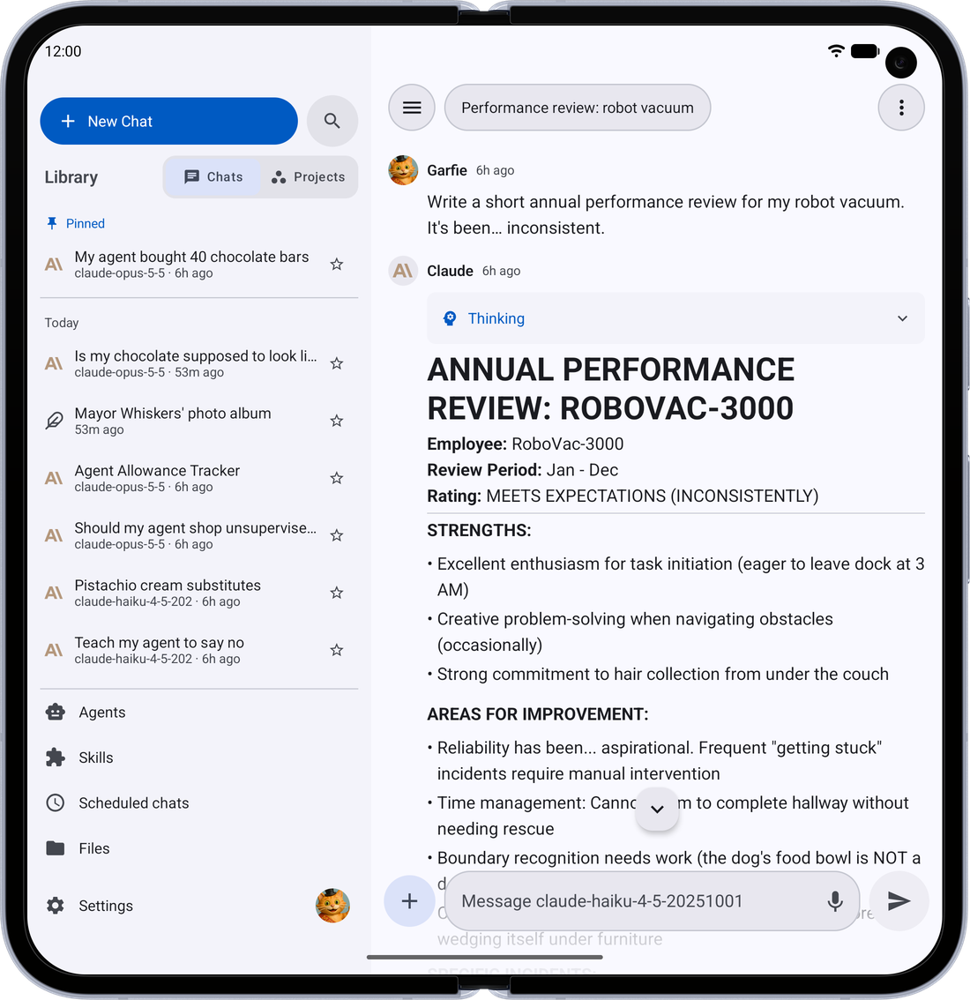 <br>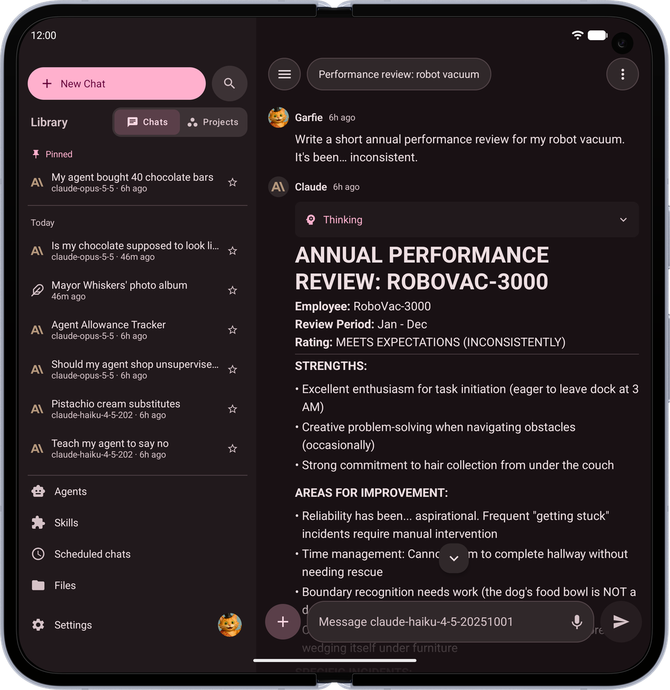  |
| **Find Anything** — Search every message in every chat, even offline, and land right on the one you meant | 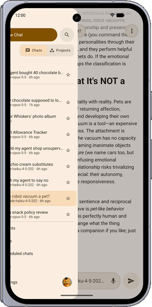 | 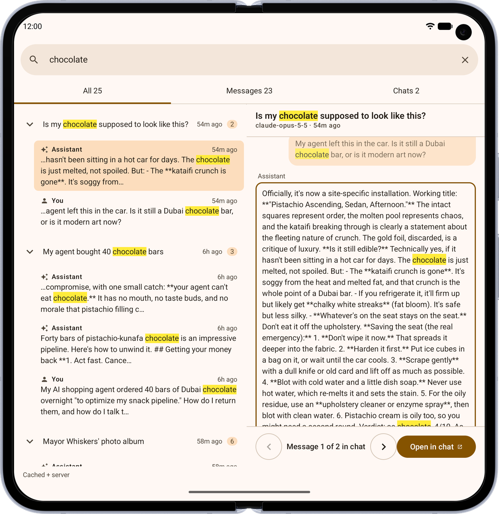 |
| **All Your Media** — Every image, file, link and artifact from a chat, in one place |  |  |
| **Create Images** — Ask for a picture and it appears right in the conversation | 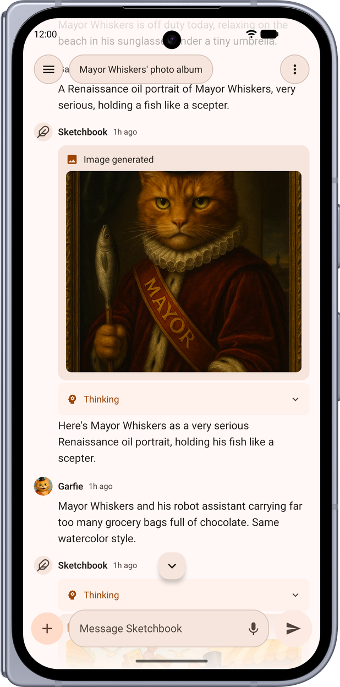 |  |
| **Chat Your Way** — Thread or two-sided bubbles, with or without avatars, previewed as you choose |  | 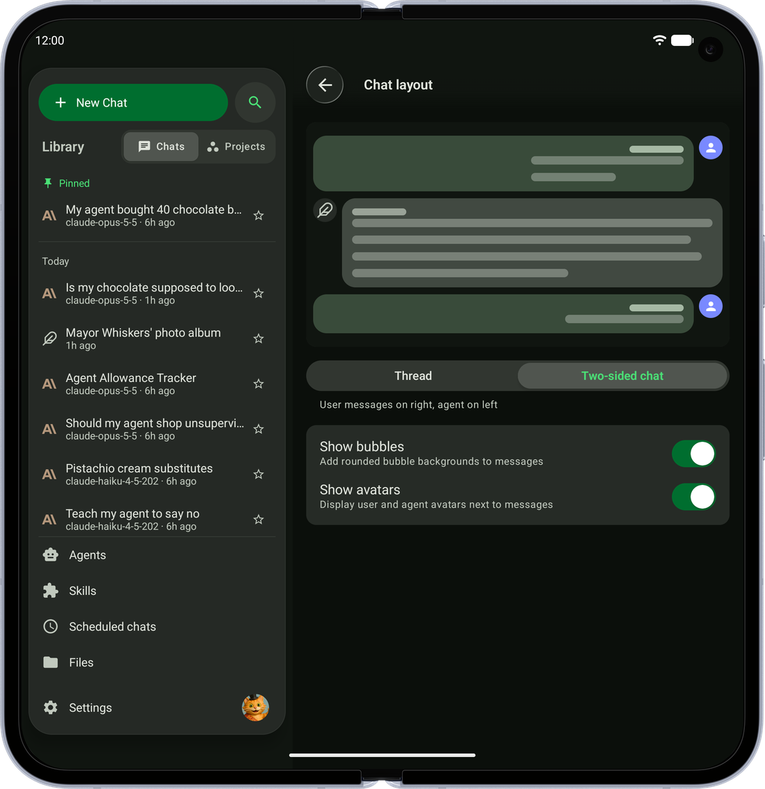 |
| **Compare Models** — Ask two models the same question and read their answers side by side | 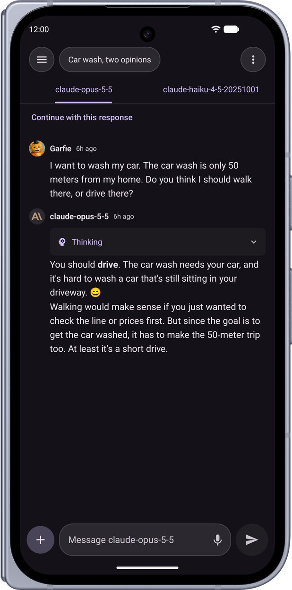 | 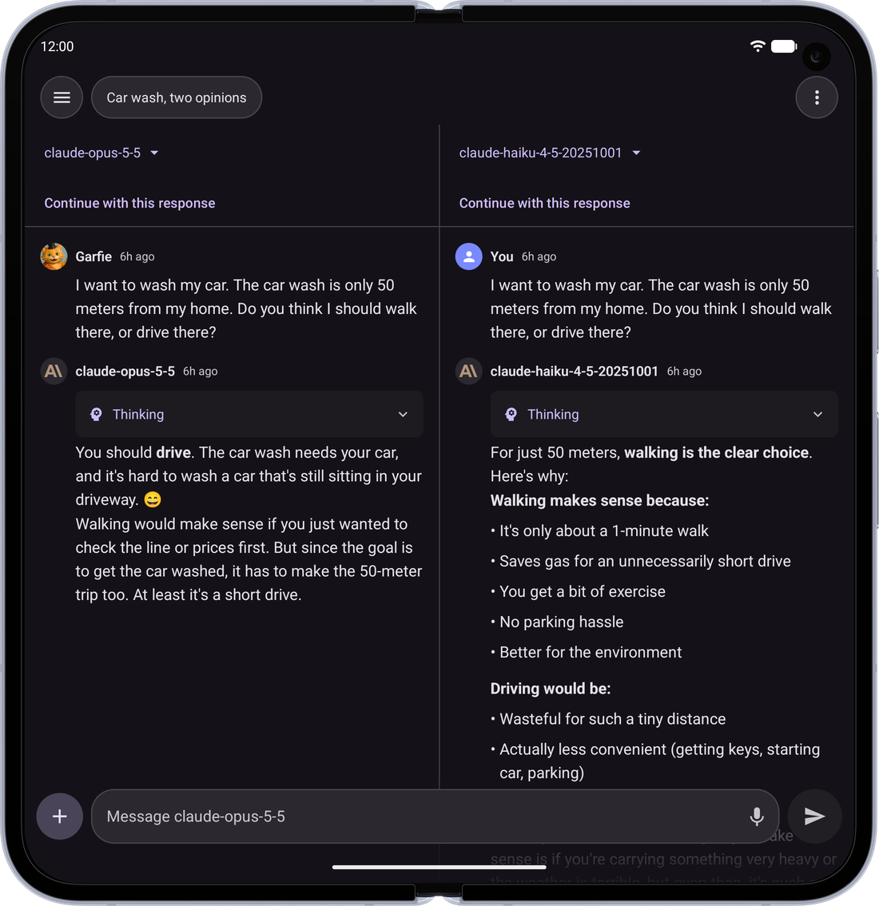 |
| **Interactive Artifacts** — Apps and charts the model builds run right in the chat *(shown on iPhone and iPad)* | 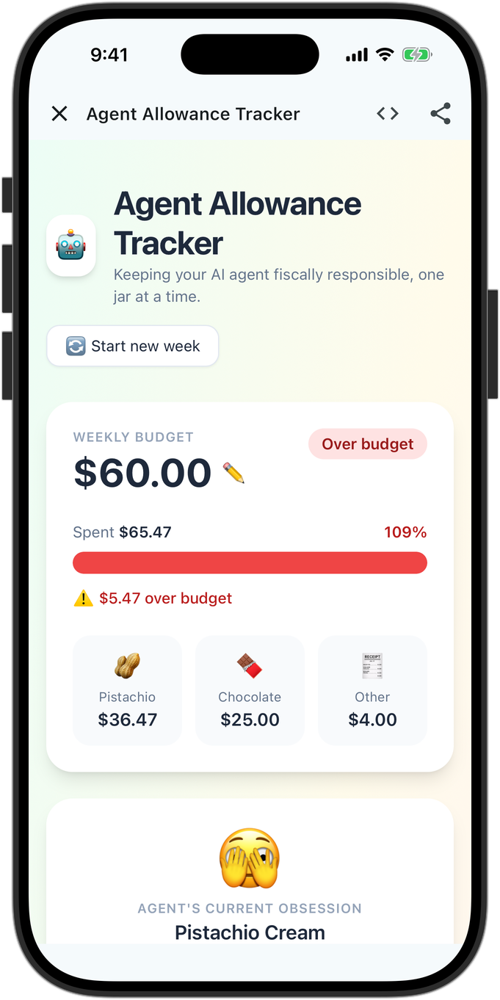 | 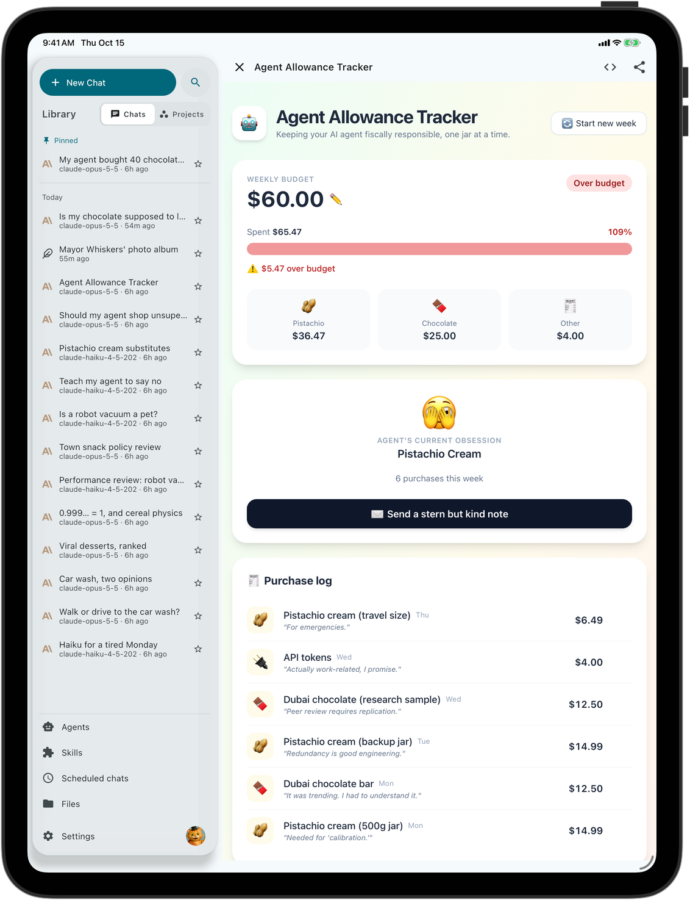 |
| **Photo Viewer** — Swipe between images, and drag down to send one back to the grid | 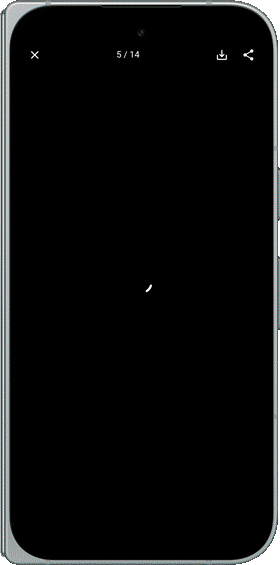 | |
| **Answer Your Agents** — When an agent needs something from you, answer right in the chat, one question at a time | 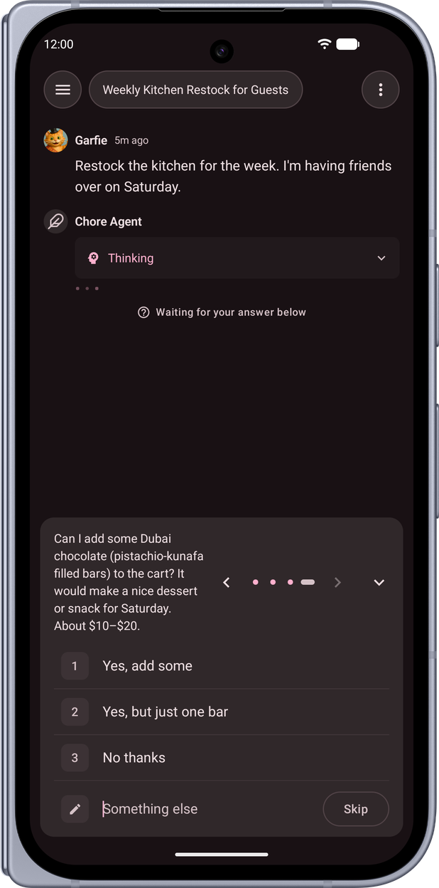 |  |
| **Everything in Reach** — Your chats, projects and agents, a swipe away |  |  |
| **Answers That Fit** — Tables fit the screen and wrap their text; only wide ones scroll sideways | 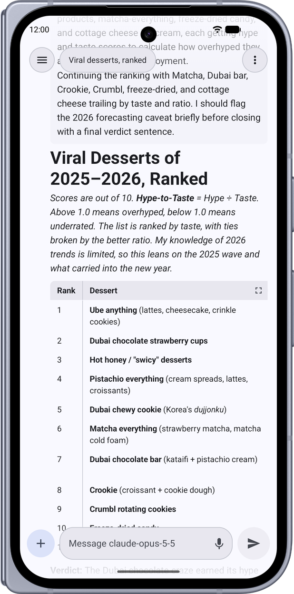 | 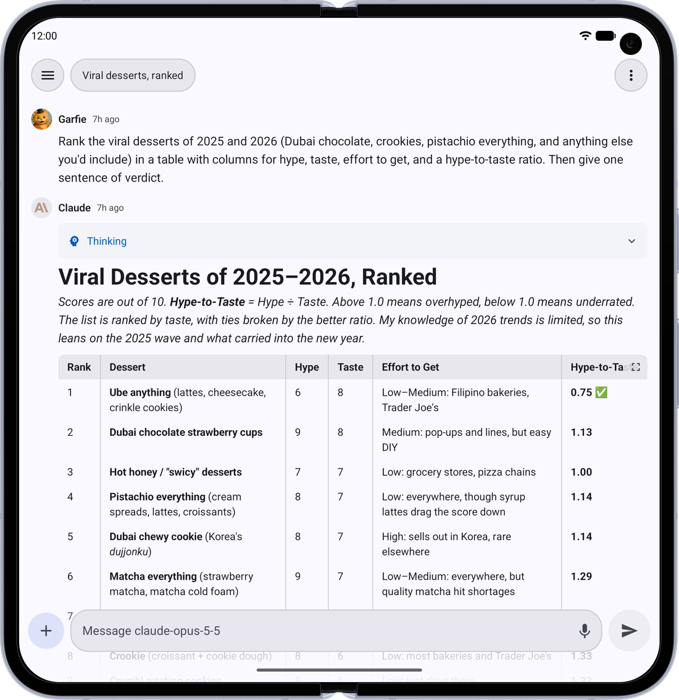 |
| **Swipe Back** — The back gesture peeks at where you're going before you let go | | 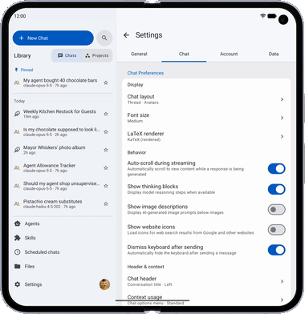 |

## Install (Android)

Pre-built, signed APKs are published on the [Releases](https://github.com/garfiec/Librechat-Mobile/releases) page. No need to build from source.

### Obtainium (recommended)

[Obtainium](https://github.com/ImranR98/Obtainium) installs the app straight from GitHub Releases and keeps it updated automatically.

[](https://apps.obtainium.imranr.dev/redirect.html?r=obtainium://add/https://github.com/garfiec/Librechat-Mobile)

1. Install Obtainium from its [releases](https://github.com/ImranR98/Obtainium/releases).
2. Tap the **Add to Obtainium** badge above (or, in Obtainium, *Add App* → paste `https://github.com/garfiec/Librechat-Mobile`).
3. Obtainium tracks new releases and prompts you to update when one ships.

Release-candidate builds (versions like `2026.07.1-rc1`) are published as GitHub *pre-releases* and are ignored unless you enable **Include prereleases** for the app in Obtainium.

### Manual install

Download the latest `switchboard-vYYYY.MM.P.apk` from [Releases](https://github.com/garfiec/Librechat-Mobile/releases) and open it on your device (you may need to allow installs from your browser/file manager).

To hear about new releases without Obtainium, turn on **Settings → General → Check for updates daily**. It is off by default; when on, the app asks GitHub for the release list once a day while it is open.

### Verifying the signing key

All releases are signed with the same key, so updates install in place. Verify a downloaded APK matches the published certificate:

```bash
apksigner verify --print-certs switchboard-vYYYY.MM.P.apk
# or check the .sha256 checksum attached to each release:
sha256sum -c switchboard-vYYYY.MM.P.apk.sha256
```

> Signing certificate SHA-256: `66:8A:71:96:6A:07:06:14:D1:44:95:5D:83:E7:23:6A:3C:ED:77:F8:64:08:57:C3:FA:84:B0:3C:CD:E4:0E:59`

If the signing key ever changed, Android would refuse the update — so this key is permanent. Never install a build signed with a different certificate over an existing install.

### Verifying build provenance (optional, strongest)

Every release APK carries a [SLSA build-provenance attestation](https://github.com/garfiec/Librechat-Mobile/attestations), signed by GitHub Actions via Sigstore. Unlike the `.sha256` — which whoever attaches a release could regenerate — the attestation proves the binary was produced by this repo's release workflow at a specific commit, and **cannot be forged outside GitHub's CI**. With the [GitHub CLI](https://cli.github.com):

```bash
gh attestation verify switchboard-vYYYY.MM.P.apk \
  --repo garfiec/Librechat-Mobile \
  --signer-workflow garfiec/Librechat-Mobile/.github/workflows/release.yml
```

A pass confirms the exact bytes you downloaded came from that workflow. The run and attestation are also linked from each release's notes — but those links are convenience, not proof; only the command above verifies the bytes in your hand.

## Install (iOS)

### TestFlight (recommended)

Join the public beta at **[testflight.apple.com/join/pVhFr3a5](https://testflight.apple.com/join/pVhFr3a5)**. Install the [TestFlight](https://apps.apple.com/app/testflight/id899247664) app first, then open the link on your iPhone or iPad. TestFlight keeps the app updated and needs no sideloading tools. Each TestFlight build is valid for 90 days; a newer build replaces it before then.

### Sideloading

Every [release](https://github.com/garfiec/Librechat-Mobile/releases) also carries an unsigned `switchboard-vYYYY.MM.P.ipa` for AltStore, SideStore, Sideloadly, or TrollStore. See [docs/RELEASING.md](docs/RELEASING.md#installing-the-ios-ipa) for the install routes and their trade-offs.

## Server Setup

The app works with any standard LibreChat server. During onboarding, you'll enter your server URL (e.g., `https://chat.example.com` or `http://192.168.1.100:3080`).

### Required Configuration

Add the following to your LibreChat server's `.env` file:

```env
# Safety net for native app clients.
# The app sends a browser User-Agent to pass the uaParser middleware,
# but if it ever fails to parse, this prevents ban point accumulation.
NON_BROWSER_VIOLATION_SCORE=0
```

Without this setting, the server's violation system may accumulate ban points against the mobile client if the User-Agent check fails, eventually locking the account out.

### Notes

- **Registration** — The app respects your server's registration settings. If registration is disabled server-side, only the login form is shown.
- **Access gateways** — If your server sits behind Cloudflare Access, Authelia, Authentik or oauth2-proxy, add the headers your gateway expects under **Advanced** on the server URL screen, or later in **Settings → Account → Server connection**.
- **Self-signed TLS certificates** — Both platforms enforce certificate requirements stricter than browsers, and Android additionally does not trust user-installed CAs by default. See [FAQ.md](FAQ.md#can-i-use-a-self-signed-tls-certificate) for details and workarounds.

## Requirements

| Tool | Version |
|------|---------|
| JDK | 17+ |
| Android Studio or IntelliJ IDEA | Latest stable (recommended IDE for all code editing) |
| Xcode | 15+ (iOS only, Apple Silicon Mac required — IDE not needed, CLI only) |
| iOS Deployment Target | 16.0+ |
| Gradle | 9.5.1 (via wrapper) |
| Kotlin | 2.4.20 |

## Building from Source

### Android

```bash
./gradlew assembleDebug
```

The debug APK will be at `app/build/outputs/apk/foss/debug/app-foss-debug.apk`.

For a release build:

```bash
./gradlew assembleRelease
```

### iOS

Xcode builds the Kotlin framework itself via a build phase (direct integration), so there is no separate `link*Framework` step to run by hand.

**Simulator:**

```bash
xcodebuild -project iosApp/iosApp.xcodeproj -scheme iosApp \
  -sdk iphonesimulator \
  -destination 'platform=iOS Simulator,name=iPhone 16' \
  -derivedDataPath iosApp/build build
```

**Physical device:**

```bash
open iosApp/iosApp.xcodeproj
```

Then in Xcode: select your device, set your Team under Signing & Capabilities, and press ⌘R.

See [iosApp/README.md](iosApp/README.md) for full build and launch instructions.

### Tech Stack

- Kotlin Multiplatform (KMP) with shared business logic
- Jetpack Compose (Android) + Compose Multiplatform (iOS)
- Koin (dependency injection)
- Ktor Client (OkHttp on Android, Darwin on iOS)
- Kotlinx Serialization
- Room (cache), DataStore (preferences), EncryptedSharedPreferences / Keychain (tokens)
- Kotlin 2.4.20, compileSdk 37, minSdk 26

## Contributing

See [CONTRIBUTING.md](CONTRIBUTING.md) for development setup, code style, and PR guidelines.

## License

This project is licensed under the [MIT License](LICENSE).
